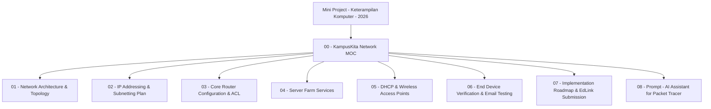

# KampusKita Network MOC (Map of Content)

> 🧭 **Proyek Induk:** [[Mini Project - Keterampilan Komputer - 2026]]  
> 👥 **Pembagian Kerja 4 Orang:** [[Team 4-Person Division/00 - Team Overview & Roadmap|Buka Folder Pembagian Kerja 4 Orang]]  
> *(💡 Tips Obsidian: Tahan tombol **Ctrl** lalu klik link, atau klik langsung pada mode **Reading View**).*

---

## 📌 Peta Modul Proyek (Cluster Jaringan KampusKita)

Semua modul berikut berada di dalam satu folder dan saling terhubung secara terstruktur di Obsidian Graph View:

### 1. Fondasi & Desain Arsitektur
- **[[01 - Network Architecture & Topology]]**: Arsitektur 4 zona (Server, Lab, Admin, Tamu), hierarki switch, router gateway, dan access point.
- **[[02 - IP Addressing & Subnetting Plan]]**: Alokasi subnet IPv4 (/24), IP statis server farm, pool DHCP, default gateway, dan tabel alokasi perangkat.

### 2. Implementasi Jaringan & Keamanan
- **[[03 - Core Router Configuration & ACL]]**: Konfigurasi interface router, routing antar-zona, dan Extended Access Control List (ACL) pemblokiran Mail Server untuk subnet WiFi Tamu.
- **[[04 - Server Farm Services]]**: Konfigurasi layanan DNS (`kampuskita.ac.id`), Web HTTP, Cloud FTP, dan Mail SMTP/POP3.
- **[[05 - DHCP & Wireless Access Points]]**: Setup 3 DHCP server terdistribusi, broadcast SSID WPA2 (Admin) dan Open SSID (Tamu).

### 3. Eksekusi & Validasi
- **[[06 - End Device Verification & Email Testing]]**: Prosedur uji end-to-end (Ping, Web, FTP, Email Client antar PC/Laptop/HP, dan verifikasi drop ACL).
- **[[07 - Implementation Roadmap & EdLink Submission]]**: Roadmap pengerjaan kelompok, checklist rubrik nilai A, penyusunan PDF report, dan export `.pkt` ke EdLink.
- **[[08 - Prompt - AI Assistant for Packet Tracer]]**: Master prompt untuk generating konfigurasi CLI Cisco dan otomatisasi pembuatan catatan berjejaring di Obsidian.
