# Network Architecture & Topology — KampusKita University

> 🧭 **Navigasi Cepat:** [[00 - KampusKita Network MOC|🏠 Hub MOC]] • [[02 - IP Addressing & Subnetting Plan|🔢 Rencana IP]] • [[03 - Core Router Configuration & ACL|🛡️ Router & ACL]]  
> *(💡 Tips Obsidian: Tahan tombol **Ctrl** lalu klik link, atau klik langsung pada mode **Reading View**).*

Dokumen ini mendefinisikan arsitektur topologi jaringan **KampusKita University** sesuai referensi resmi **Gambar 1 (Ilustrasi topologi jaringan di KampusKita University)**. Topologi berbasis bintang bertingkat (*hierarchical star*) terpusat pada **ROUTER UTAMA** (`Router-PT`) dan 4 unit Switch distribusi (`2960-24TT`) yang dikelompokkan dalam 4 zona berwarna.

---

## 1. Diagram Visual Topologi Resmi (Gambar 1)

```mermaid
flowchart TD
    Router["ROUTER UTAMA<br>(Router-PT)"]

    subgraph ServerZone["Zona Server (Cyan / 192.168.10.0/24)"]
        SW_Server["SW-SERVER<br>(2960-24TT)"]
        DNS["DNS-SERVER<br>192.168.10.2"]
        WEB["WEB-SERVER<br>192.168.10.3"]
        FTP["FTP-SERVER<br>192.168.10.4"]
        MAIL["MAIL-SERVER<br>192.168.10.5"]
        SW_Server --> DNS
        SW_Server --> WEB
        SW_Server --> FTP
        SW_Server --> MAIL
    end

    subgraph LabZone["Zona Lab Komputer (Orange / 192.168.20.0/24)"]
        SW_Lab["SW-LAB-KOMPUTER<br>(2960-24TT)"]
        DHCP_Lab["DHCP-SERVER-LAB-KOMPUTER<br>192.168.20.2"]
        PC_Lab1["PC-LAB-1"]
        PC_Lab2["PC-LAB-2"]
        PC_Lab3["PC-LAB-3"]
        PC_Lab4["PC-LAB-4"]
        PC_Lab5["PC-LAB-5"]
        SW_Lab --> DHCP_Lab
        SW_Lab --> PC_Lab1
        SW_Lab --> PC_Lab2
        SW_Lab --> PC_Lab3
        SW_Lab --> PC_Lab4
        SW_Lab --> PC_Lab5
    end

    subgraph AdminZone["Zona Admin (Kuning / 192.168.30.0/24)"]
        SW_Admin["SW-ADMIN<br>(2960-24TT)"]
        DHCP_Admin["DHCP-SERVER-ADMIN<br>192.168.30.2"]
        PC_Admin1["PC-ADMIN-1"]
        PC_Admin2["PC-ADMIN-2"]
        PC_Admin3["PC-ADMIN-3"]
        SW_Admin --> DHCP_Admin
        SW_Admin --> PC_Admin1
        SW_Admin --> PC_Admin2
        SW_Admin --> PC_Admin3
    end

    subgraph UmumZone["Zona Umum / Hotspot (Pink / 192.168.40.0/24)"]
        SW_Umum["SW-UMUM<br>(2960-24TT)"]
        DHCP_Umum["DHCP-SERVER-UMUM<br>192.168.40.2"]
        HR_Tamu["HomeRouter WIFI-TAMU<br>(Open / No Pass)"]
        HR_Mhs["HomeRouter WIFI-MAHASISWA<br>(WPA2-PSK)"]
        HR_Dosen["HomeRouter WIFI-DOSEN<br>(WPA2-PSK)"]

        Tamu1["LaptopTamu-1"]
        Tamu2["SmartphoneTamu-1"]
        Mhs1["LaptopMahasiswa-1"]
        Mhs2["LaptopMahasiswa-2"]
        Dosen1["LaptopDosen-1"]
        Dosen2["LaptopDosen-2"]

        SW_Umum --> DHCP_Umum
        SW_Umum --> HR_Tamu
        SW_Umum --> HR_Mhs
        SW_Umum --> HR_Dosen

        HR_Tamu -. Wireless .-> Tamu1
        HR_Tamu -. Wireless .-> Tamu2
        HR_Mhs -. Wireless .-> Mhs1
        HR_Mhs -. Wireless .-> Mhs2
        HR_Dosen -. Wireless .-> Dosen1
        HR_Dosen -. Wireless .-> Dosen2
    end

    Router -- "Fa0/0" --> SW_Server
    Router -- "Fa1/0" --> SW_Lab
    Router -- "Fa2/0" --> SW_Admin
    Router -- "Fa3/0" --> SW_Umum
```

---

## 2. Inventaris Perangkat Sesuai Gambar 1

### A. Core Routing
- **1x `Router-PT` (ROUTER UTAMA):**
  - Dilengkapi modul port FastEthernet (`Fa0/0`, `Fa1/0`, `Fa2/0`, `Fa3/0`) untuk mengarahkan trafik antar 4 switch zona dan mengontrol Extended ACL pemblokiran Mail Server.

### B. Distribusi Switching
- **4x `2960-24TT`:**
  1. `SW-SERVER`: Menghubungkan seluruh server layanan utama kampus.
  2. `SW-LAB-KOMPUTER`: Menghubungkan 5 unit PC praktikum dan 1 DHCP server lab.
  3. `SW-ADMIN`: Menghubungkan 3 unit PC tata usaha/pegawai dan 1 DHCP server admin.
  4. `SW-UMUM`: Menghubungkan 1 DHCP server umum dan 3 unit router nirkabel (`HomeRouter-PT-AC`).

### C. Rincian Perangkat End Device & Server Per Zona

| Zona (Warna) | Switch | Perangkat Terhubung (Sesuai Gambar 1) | Tipe IP |
| :--- | :--- | :--- | :--- |
| **Zona Server** *(Cyan)* | `SW-SERVER` | • `DNS-SERVER` • `WEB-SERVER` • `FTP-SERVER` • `MAIL-SERVER` | Statis (`192.168.10.0/24`) |
| **Zona Lab Komputer** *(Orange)* | `SW-LAB-KOMPUTER` | • `DHCP-SERVER-LAB-KOMPUTER` • `PC-LAB-1` • `PC-LAB-2` • `PC-LAB-3` • `PC-LAB-4` • `PC-LAB-5` | Server: Statis PC: DHCP (`192.168.20.0/24`) |
| **Zona Admin** *(Kuning)* | `SW-ADMIN` | • `DHCP-SERVER-ADMIN` • `PC-ADMIN-1` • `PC-ADMIN-2` • `PC-ADMIN-3` | Server: Statis PC: DHCP (`192.168.30.0/24`) |
| **Zona Umum** *(Pink)* | `SW-UMUM` | • `DHCP-SERVER-UMUM` • `HomeRouter-PT-AC` (`WIFI-TAMU`) • `HomeRouter-PT-AC` (`WIFI-MAHASISWA`) • `HomeRouter-PT-AC` (`WIFI-DOSEN`) • `LaptopTamu-1`, `SmartphoneTamu-1` • `LaptopMahasiswa-1`, `LaptopMahasiswa-2` • `LaptopDosen-1`, `LaptopDosen-2` | Server: Statis Klien: DHCP (`192.168.40.0/24`) |

---

## 3. Jenis Kabel & Skema Pengkabelan

1. **Copper Straight-Through (Garis Hitam Solid):**
   - Router ke Switch: `ROUTER UTAMA` ke masing-masing 4 Switch.
   - Switch ke Server: `SW-SERVER` ke 4 Server, serta ke 3 DHCP Server.
   - Switch ke PC: `SW-LAB-KOMPUTER` ke `PC-LAB-1` s/d `PC-LAB-5`, `SW-ADMIN` ke `PC-ADMIN-1` s/d `PC-ADMIN-3`.
   - Switch ke Wireless Router: `SW-UMUM` ke port Internet / Ethernet pada 3x `HomeRouter-PT-AC`.
2. **Wireless / Nirkabel (Garis Putus-Putus Gelombang):**
   - `WIFI-TAMU` ➔ `LaptopTamu-1` & `SmartphoneTamu-1` (SSID Open, tanpa password).
   - `WIFI-MAHASISWA` ➔ `LaptopMahasiswa-1` & `LaptopMahasiswa-2`.
   - `WIFI-DOSEN` ➔ `LaptopDosen-1` & `LaptopDosen-2`.

---

## 🔗 Referensi Silang
- Alokasi IP Detail Perangkat: [[02 - IP Addressing & Subnetting Plan]]
- Konfigurasi Router Utama & ACL: [[03 - Core Router Configuration & ACL]]
- Setup 3 HomeRouter & DHCP: [[05 - DHCP & Wireless Access Points]]
