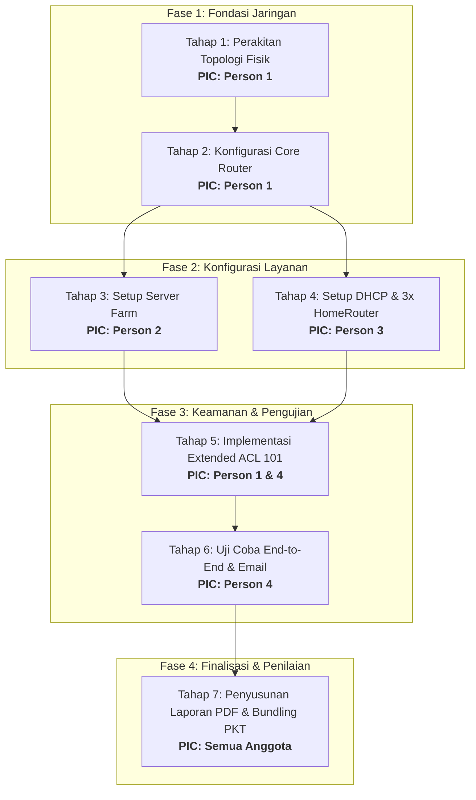

# Implementation Roadmap & EdLink Submission — KampusKita University

> **MOC:** [[00 - KampusKita Network MOC]] | **Soal Induk:** [[Mini Project - Keterampilan Komputer - 2026]] | **Uji Validasi:** [[06 - End Device Verification & Email Testing]]

Roadmap implementasi ini dirancang agar kelompok 4 orang menyelesaikan proyek lebih awal sebelum Pertemuan 15 untuk mengunci **Nilai Akhir A** sesuai rubrik RPS mata kuliah Keterampilan Komputer.

---

## 🗺️ Roadmap Interaktif Alur Kerja (Klik Node untuk Buka Catatan)

Diagram flowchart berikut bersifat interaktif di Obsidian. Klik pada masing-masing kotak tahapan untuk langsung membuka dokumen panduan teknis yang dibutuhkan:

---

## 👥 Pembagian Peran Kerja Tim (4 Orang)

Tuliskan nama dan NIM masing-masing anggota pada lembar laporan resmi:

### 1. Person 1 — Network Architect & Routing Lead
- **Tanggung Jawab Utama:**
  - Merakit kanvas Packet Tracer: 1x `Router-PT`, 4x Switch `2960-24TT`, dan pengkabelan Copper Straight-Through.
  - Memasukkan konfigurasi CLI `ROUTER UTAMA`: IP Gateway 4 interface (`Fa0/0`, `Fa1/0`, `Fa2/0`, `Fa3/0`) dan `no shutdown`.
  - Mengonfigurasi **Extended ACL 101** pada `Fa3/0` (Inbound) untuk memblokir akses dari Subnet Tamu ke `MAIL-SERVER`.
- **Dokumen Panduan:** [[01 - Network Architecture & Topology]] & [[03 - Core Router Configuration & ACL]].

### 2. Person 2 — Server Farm Administrator
- **Tanggung Jawab Utama:**
  - Mengonfigurasi 4 server statis di Subnet Server (`192.168.10.0/24`).
  - **DNS-SERVER (`10.2`):** Menambahkan A-Record (`kampuskita.ac.id`, `ftp...`, `mail...`).
  - **WEB-SERVER (`10.3`):** Mengaktifkan HTTP/HTTPS dan mengedit portal `index.html`.
  - **FTP-SERVER (`10.4`):** Mengaktifkan FTP dan membuat akun user `admin` & `mahasiswa`.
  - **MAIL-SERVER (`10.5`):** Mengeset domain `kampuskita.ac.id` dan membuat akun email civitas akademika.
- **Dokumen Panduan:** [[04 - Server Farm Services]] & [[02 - IP Addressing & Subnetting Plan]].

### 3. Person 3 — DHCP & Wireless Specialist
- **Tanggung Jawab Utama:**
  - Mengonfigurasi 3 unit DHCP Server fisik (`DHCP-SERVER-LAB-KOMPUTER`, `DHCP-SERVER-ADMIN`, `DHCP-SERVER-UMUM`) beserta IP pool masing-masing.
  - Mengonfigurasi 3 unit `HomeRouter-PT-AC`:
    - `WIFI-TAMU`: SSID Open (Authentication: Disabled).
    - `WIFI-MAHASISWA`: SSID WPA2-PSK.
    - `WIFI-DOSEN`: SSID WPA2-PSK.
  - Memastikan seluruh laptop, PC, dan smartphone terhubung ke switch/WiFi dan sukses memperoleh IP otomatis (`DHCP request successful`).
- **Dokumen Panduan:** [[05 - DHCP & Wireless Access Points]].

### 4. Person 4 — QA, Testing & Technical Report Lead
- **Tanggung Jawab Utama:**
  - Menjalankan 10 skenario pengujian matriks (U-01 s.d. U-10) di [[06 - End Device Verification & Email Testing]].
  - Memastikan live-testing pengiriman & penerimaan email antar PC/Laptop berjalan lancar.
  - Menguji dan mengambil screenshot bukti drop ACL saat `SmartphoneTamu-1` mencoba mengakses `MAIL-SERVER` (`Destination host unreachable`).
  - Menyusun dokumen resmi Laporan PDF (Cover, peran anggota, topologi, tabel IP, konfigurasi, screenshot hasil uji, kesimpulan).
  - Mengompresi `.pdf` dan `.pkt` ke dalam format `.zip` untuk pengumpulan EdLink.
- **Dokumen Panduan:** [[06 - End Device Verification & Email Testing]].

---

## 📋 Checklist Lengkap Perangkat Gambar 1

- [ ] **Router:** 1x `Router-PT` (`ROUTER UTAMA`) dengan 4 port FastEthernet aktif (`Fa0/0`, `Fa1/0`, `Fa2/0`, `Fa3/0`).
- [ ] **Switch:** 4x `2960-24TT` (`SW-SERVER`, `SW-LAB-KOMPUTER`, `SW-ADMIN`, `SW-UMUM`).
- [ ] **Zona Server (4 unit):** `DNS-SERVER`, `WEB-SERVER`, `FTP-SERVER`, `MAIL-SERVER` (IP Statis).
- [ ] **Zona Lab Komputer (6 unit):** 1x `DHCP-SERVER-LAB-KOMPUTER` + 5x PC (`PC-LAB-1` s.d. `PC-LAB-5`).
- [ ] **Zona Admin (4 unit):** 1x `DHCP-SERVER-ADMIN` + 3x PC (`PC-ADMIN-1` s.d. `PC-ADMIN-3`).
- [ ] **Zona Umum (10 unit):**
  - 1x `DHCP-SERVER-UMUM`
  - 3x `HomeRouter-PT-AC` (`WIFI-TAMU`, `WIFI-MAHASISWA`, `WIFI-DOSEN`)
  - 2x Klien Tamu (`LaptopTamu-1`, `SmartphoneTamu-1`)
  - 2x Klien Mahasiswa (`LaptopMahasiswa-1`, `LaptopMahasiswa-2`)
  - 2x Klien Dosen (`LaptopDosen-1`, `LaptopDosen-2`)

---

## 📦 Berkas Submission EdLink

Batas akhir pengumpulan: **Maksimal 31 Desember 2026 / Sebelum Pertemuan 15**.

Format berkas akhir: **Satu file `.zip`**, berisi 2 file di dalamnya:
1. `Laporan_Mini_Project_KampusKita_KelompokX.pdf`
2. `Topologi_KampusKita_KelompokX.pkt`

Nama file zip: `MiniProject_KeterampilanKomputer_KelompokX.zip`.

---

## 🔗 Referensi Silang
- Dokumen Proyek Induk: [[Mini Project - Keterampilan Komputer - 2026]]
- Prosedur Uji Matriks: [[06 - End Device Verification & Email Testing]]
- Desain Arsitektur: [[01 - Network Architecture & Topology]]
