# Desain & Simulasi Jaringan Terpadu KampusKita University
### Mini Project Mata Kuliah Keterampilan Komputer — 2026/2027

Repository ini berisi dokumentasi teknis lengkap, rencana pengalamatan IP, konfigurasi CLI Cisco IOS, aturan Extended ACL keamanan, serta panduan pengujian simulasi jaringan menggunakan **Cisco Packet Tracer**.

---

## 📌 Gambaran Umum Topologi

Topologi berbasis arsitektur bintang hierarkis terpusat pada **ROUTER UTAMA** (`Router-PT`) yang membagi jaringan ke dalam 4 zona utama melalui 4 switch distribusi (`2960-24TT`):

```mermaid
flowchart TD
    Router["ROUTER UTAMA<br>(Router-PT)"]

    subgraph ServerZone["Zona Server (Cyan / 192.168.10.0/24)"]
        SW_Server["SW-SERVER<br>(2960-24TT)"]
        DNS["DNS-SERVER<br>192.168.10.2"]
        WEB["WEB-SERVER<br>192.168.10.3"]
        FTP["FTP-SERVER<br>192.168.10.4"]
        MAIL["MAIL-SERVER<br>192.168.10.5"]
        SW_Server --> DNS & WEB & FTP & MAIL
    end

    subgraph LabZone["Zona Lab Komputer (Orange / 192.168.20.0/24)"]
        SW_Lab["SW-LAB-KOMPUTER<br>(2960-24TT)"]
        DHCP_Lab["DHCP-SERVER-LAB-KOMPUTER<br>192.168.20.2"]
        PC_Lab["5x Workstation PC-LAB"]
        SW_Lab --> DHCP_Lab & PC_Lab
    end

    subgraph AdminZone["Zona Admin (Kuning / 192.168.30.0/24)"]
        SW_Admin["SW-ADMIN<br>(2960-24TT)"]
        DHCP_Admin["DHCP-SERVER-ADMIN<br>192.168.30.2"]
        PC_Admin["3x PC Pegawai"]
        SW_Admin --> DHCP_Admin & PC_Admin
    end

    subgraph UmumZone["Zona Umum / Hotspot (Pink / 192.168.40.0/24)"]
        SW_Umum["SW-UMUM<br>(2960-24TT)"]
        DHCP_Umum["DHCP-SERVER-UMUM<br>192.168.40.2"]
        HR_Tamu["HomeRouter WIFI-TAMU<br>(Open / No Pass)"]
        HR_Mhs["HomeRouter WIFI-MAHASISWA<br>(WPA2-PSK)"]
        HR_Dosen["HomeRouter WIFI-DOSEN<br>(WPA2-PSK)"]

        SW_Umum --> DHCP_Umum & HR_Tamu & HR_Mhs & HR_Dosen
    end

    Router -- "Fa0/0" --> SW_Server
    Router -- "Fa1/0" --> SW_Lab
    Router -- "Fa2/0" --> SW_Admin
    Router -- "Fa3/0" --> SW_Umum
```



---

## 👥 Pembagian Peran Tim (4 Orang)

Tersedia folder operasional khusus di dalam repository ini: [📂 Team 4-Person Division](Team%204-Person%20Division/00%20-%20Team%20Overview%20%26%20Roadmap.md)

| Peran | Panduan Kerja Mandiri | Tugas Utama |
| :--- | :--- | :--- |
| **Person 1** | [📘 Panduan Person 1](Team%204-Person%20Division/Person%201%20-%20Network%20Architect%20%26%20Routing%20Lead.md) | Perakitan kanvas Packet Tracer, konfigurasi interface gateway Router Utama, dan Extended ACL 101. |
| **Person 2** | [📘 Panduan Person 2](Team%204-Person%20Division/Person%202%20-%20Server%20Farm%20Administrator.md) | Setup 4 Server (DNS `kampuskita.ac.id`, Web HTTP, Cloud FTP, dan Mail SMTP/POP3). |
| **Person 3** | [📘 Panduan Person 3](Team%204-Person%20Division/Person%203%20-%20DHCP%20%26%20Wireless%20Specialist.md) | Konfigurasi 3 unit DHCP Server dedicated dan 3 unit `HomeRouter-PT-AC` (Tamu Open, Mahasiswa, Dosen). |
| **Person 4** | [📘 Panduan Person 4](Team%204-Person%20Division/Person%204%20-%20QA%20Testing%20%26%20Report%20Lead.md) | Eksekusi matriks pengujian (Ping, Web, FTP, Email antar client, validasi drop ACL Tamu), kompilasi PDF Report & file `.pkt`. |

---

## 📊 Rangkuman Subnetting & IP Addressing

| Zona | Subnet | Gateway Router | IP Server / Host | Keterangan |
| :--- | :--- | :--- | :--- | :--- |
| **Server Farm** | `192.168.10.0/24` | `192.168.10.1` (`Fa0/0`) | `192.168.10.2` - `192.168.10.5` | DNS, Web, FTP, Mail (Statis) |
| **Lab Komputer** | `192.168.20.0/24` | `192.168.20.1` (`Fa1/0`) | DHCP Pool: `.10` - `.254` | 5 Unit PC Praktikum |
| **Bagian Admin** | `192.168.30.0/24` | `192.168.30.1` (`Fa2/0`) | DHCP Pool: `.10` - `.254` | 3 Unit PC Pegawai |
| **Bagian Umum** | `192.168.40.0/24` | `192.168.40.1` (`Fa3/0`) | DHCP Pool: `.10` - `.254` | 3 HomeRouter & Klien Wireless |

---

## 🔒 Extended ACL 101 (Pemblokiran Mail Server untuk Tamu)

Sesuai spesifikasi proyek, pengguna yang terhubung melalui WiFi Tamu dilarang mengakses Mail Server:

```cisco
access-list 101 deny ip 192.168.40.0 0.0.0.255 host 192.168.10.5
access-list 101 permit ip any any

interface FastEthernet3/0
 ip access-group 101 in
 exit
```

---

## 📂 Struktur Modul Catatan

- `00 - KampusKita Network MOC.md`: Pusat peta konsep (Map of Content).
- `01 - Network Architecture & Topology.md`: Desain topologi resmi & inventaris perangkat Gambar 1.
- `02 - IP Addressing & Subnetting Plan.md`: Alokasi IP statis dan konfigurasi pool DHCP.
- `03 - Core Router Configuration & ACL.md`: Panduan CLI router gateway dan aturan filter ACL.
- `04 - Server Farm Services.md`: Konfigurasi DNS, HTTP Web, FTP, dan Mail Server.
- `05 - DHCP & Wireless Access Points.md`: Panduan setup 3 DHCP server dan 3x HomeRouter.
- `06 - End Device Verification & Email Testing.md`: Matriks pengujian konektivitas dan email client.
- `07 - Implementation Roadmap & EdLink Submission.md`: Roadmap pengerjaan kelompok dan berkas EdLink.
- `08 - Prompt - AI Assistant for Packet Tracer.md`: Prompt generator simulasi jaringan dan Obsidian graph.
- `Mini Project - Keterampilan Komputer - 2026.md`: Lembar penugasan asli proyek.
