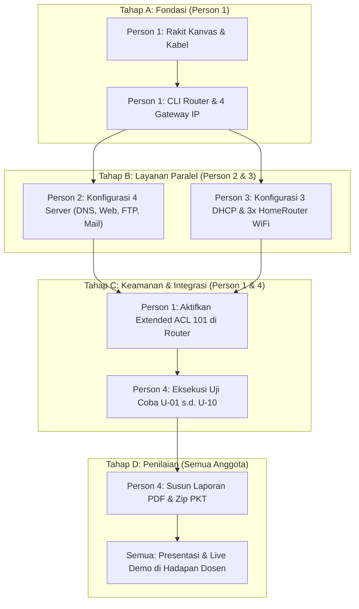

# Team Overview & Roadmap — Pembagian Kerja 4 Orang

> 🧭 **Navigasi Cepat:** [[00 - KampusKita Network MOC|🏠 Hub MOC Utama]] • [[Mini Project - Keterampilan Komputer - 2026|📄 Soal Induk Proyek]]  
> *(💡 Tips Obsidian: Tahan tombol **Ctrl** lalu klik link, atau klik langsung pada mode **Reading View**).*

Folder ini adalah panduan kerja operasional khusus jika proyek **KampusKita University** dikerjakan oleh **kelompok 4 orang**. Setiap anggota memiliki dokumen panduan mandiri (*runbook*) yang merinci tugas, konfigurasi teknis, dan tanggung jawabnya secara tuntas.

---

## 👥 Matriks Tanggung Jawab 4 Anggota

| Anggota | Peran / Jabatan | Wilayah Fokus | Dokumen Panduan Kerja |
| :--- | :--- | :--- | :--- |
| **Person 1** | **Network Architect & Routing Lead** | Router Utama, 4 Switch, Pengkabelan, & Extended ACL | [[Person 1 - Network Architect & Routing Lead\|Buka Panduan Person 1]] |
| **Person 2** | **Server Farm Administrator** | 4 Server Layanan (DNS, Web, FTP, Mail) | [[Person 2 - Server Farm Administrator\|Buka Panduan Person 2]] |
| **Person 3** | **DHCP & Wireless Specialist** | 3 DHCP Server, 3x HomeRouter WiFi, & End Devices | [[Person 3 - DHCP & Wireless Specialist\|Buka Panduan Person 3]] |
| **Person 4** | **QA Testing, Demo & Report Lead** | Matriks Uji, Live Demo Email, ACL Drop, & Laporan PDF | [[Person 4 - QA Testing & Report Lead\|Buka Panduan Person 4]] |

---

## 🗺️ Roadmap Alur Eksekusi Tim & Dependensi

Proyek ini memiliki urutan ketergantungan kerja (*dependency chain*). Diagram berikut memperlihatkan siapa yang harus mulai terlebih dahulu dan siapa yang menunggu:

---

## 📋 Target Milestone Pengerjaan

1. **Hari 1:** Person 1 menyelesaikan perakitan topologi dan konfigurasi interface router (`Fa0/0` s.d. `Fa3/0`).
2. **Hari 2:** Person 2 menyelesaikan setup 4 server, dan Person 3 menyelesaikan setup DHCP + WiFi.
3. **Hari 3:** Person 1 memasang Extended ACL 101, Person 4 menguji seluruh komunikasi data (Web, FTP, Email, drop ACL).
4. **Hari 4:** Person 4 mengompilasi laporan PDF, latihan presentasi bersama, dan submit `.zip` ke EdLink.
